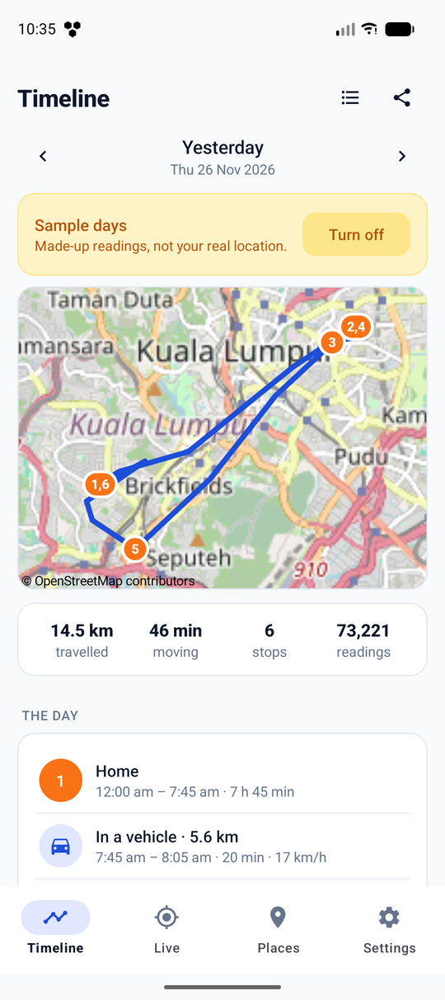
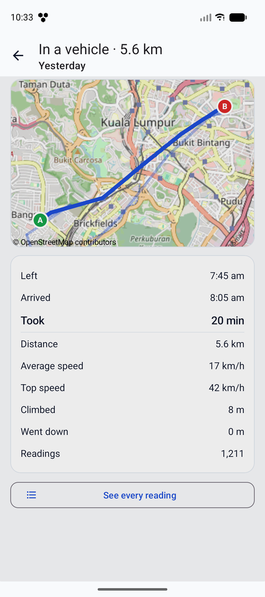
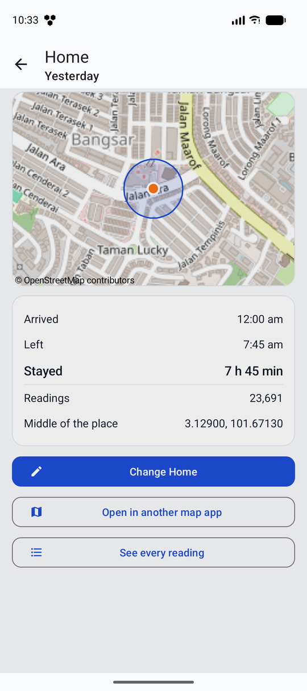
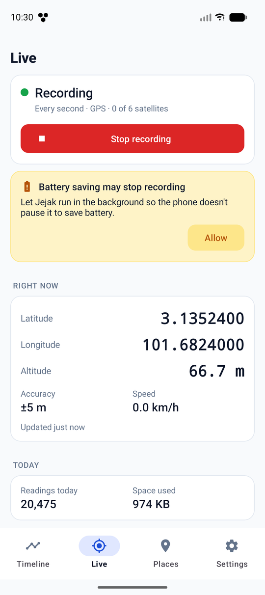
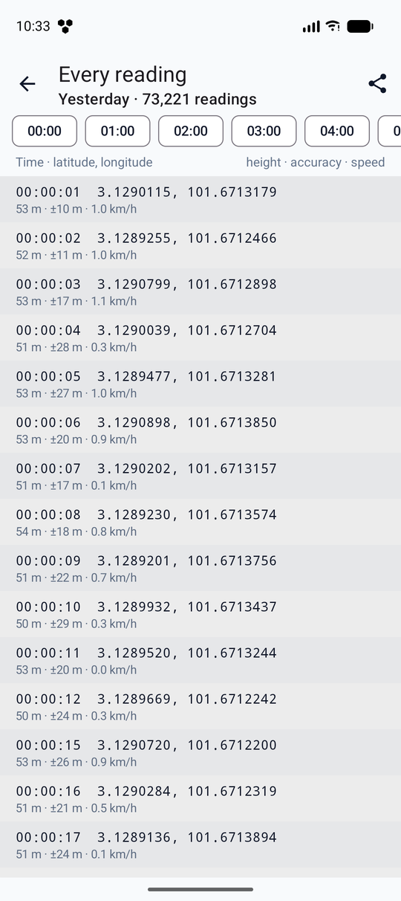
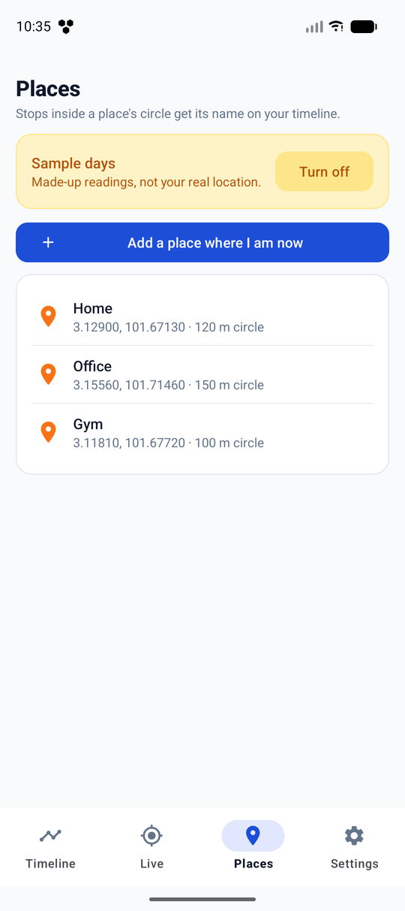
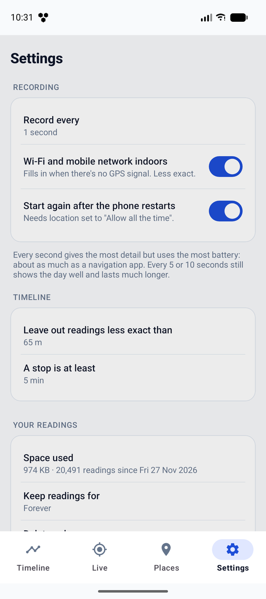

# Jejak

A GPS timeline for your phone. Jejak records where you are **every second** (latitude, longitude and altitude, with
accuracy and speed), keeps recording with the screen off, and turns each day into a timeline: the places you stopped,
how you travelled between them, and when the signal dropped. Two native apps from one repo: **Android (Java)** and
**iPhone (Swift)**. They read a day the same way, down to the metre.

| Timeline | A trip | A stop | Live |
|---|---|---|---|
|  |  |  |  |

| Every reading | Places | Settings |
|---|---|---|
|  |  |  |

## What it does

- **Records every second, in the background.** Press Start once. On Android a "Recording your timeline" notice stays
  up while it runs (Android requires it), with a Stop button. It carries on with the screen off and starts again by
  itself after the phone restarts. On iPhone it records in the background too, and if iOS closes the app it is woken
  again once you move.
- **Live.** Latitude, longitude and altitude as they come in, accuracy, speed, satellites, readings today, space used,
  and the last 20 readings. Warnings, each with a fix-it button, when something would stop recording: location off,
  precise location off, battery saving, or no "Allow all the time".
- **Timeline.** Each day on an OpenStreetMap map with numbered stops, plus distance travelled, time moving, number of
  stops and readings. Stops show how long you stayed. Trips show the distance, time and average speed, and a guess
  at how you travelled: walking, cycling, in a vehicle or flying. "No signal" marks tunnels, car parks and times the
  phone was off.
- **Tap any line** to see it on its own map, with its facts: arrival and departure, top speed, height climbed, and
  readings. You can name a stop's place, look up the street address, or open it in another map app.
- **Every reading.** The raw list for a day or a single trip: time, latitude and longitude (7 decimals, about 1 cm),
  altitude, accuracy and speed. Jump to any hour. Readings too inexact for the timeline are greyed, not hidden.
- **Places.** Name places like Home, Office or Gym, each with a circle size. Stops inside the circle get the name.
- **Export.** Any day, or one trip, as a spreadsheet (CSV, every reading) or a GPS track (GPX) for Google Earth,
  Strava, Garmin and other map apps.
- **Your readings stay on the phone.** Nothing is sent anywhere unless you export it. Choose how long to keep readings
  (forever, 1 year, 90, 30 or 7 days), delete a day, or delete everything.
- **Sample days.** Two weeks of made-up days around Kuala Lumpur to see how it works before you record your own.

## Battery and space

- **Battery:** one reading every second keeps GPS on all the time. That uses about as much battery as a navigation
  app. Settings → *Record every* 5, 10 or 30 seconds, or 1 minute, lasts much longer and still shows the day well.
- **Space:** about 30 bytes a reading, so a full day of one reading every second is about 2.5 MB, or roughly 1 GB a
  year. Settings shows how much space is used.
- **Phones that close apps** (Xiaomi, Redmi, POCO, OPPO, realme, vivo, Huawei, Honor and some Samsung): set Jejak's
  battery use to *No restrictions*, turn on *Autostart*, and lock it in recent apps. Settings has the buttons.

## Get the apps

Builds are made by GitHub Actions on every push. Open the **Actions** tab, pick the latest *Build* run and download:

- **Jejak-android** has `Jejak-1.0.0-android.apk`. Copy it to an Android phone (Android 8 or newer) and open it to
  install. You may need to allow "Install unknown apps" for your file manager.
- **Jejak-ios** has the iPhone simulator build and screenshots of every screen. To put the app on a real iPhone, open
  the project in Xcode with your Apple ID (see below) or publish it through TestFlight / the App Store.

## Repository layout

```
android/                     Android app (Java, Material 3, osmdroid maps)
  app/src/main/java/com/r4xn/jejak/core/   the rules: readings, distances, reading a day as a timeline, exports, sample days
  app/src/main/java/com/r4xn/jejak/rec/    recording: background service, database, restart after boot
  app/src/main/java/com/r4xn/jejak/ui/     screens
  app/src/test/                            tests for the rules (and the sample file the iPhone checks compare against)
ios/                         iPhone app (Swift, SwiftUI, MapKit, iOS 17+)
  JejakCore/                 the same rules as a Swift package, plus the reading database (SQLite) and checks
  Jejak/                     screens and the background recorder
  project.yml                Xcode project (made with XcodeGen)
  scripts/screenshots.sh     opens each screen in the simulator and saves a picture
.github/workflows/build.yml  builds and tests both apps
```

## Building

**Android** (JDK 17 and the Android SDK, or open `android/` in Android Studio):

```bash
cd android
./gradlew :app:testDebugUnitTest      # tests (also writes app/build/android-sample.json)
./gradlew :app:assembleDebug          # app-debug.apk
```

Debug builds open any screen with sample days, for testing and screenshots:
`adb shell am start -n com.r4xn.jejak/.ui.MainActivity --ez sample true --es sampleTime 21:30 --ei day -1 --es open timeline`
(`open` = `timeline`, `live`, `places`, `settings`, `points` or `item:N`).

**iPhone** (a Mac with Xcode 15 or newer):

```bash
cd ios
brew install xcodegen && xcodegen     # makes Jejak.xcodeproj
open Jejak.xcodeproj                  # pick your team under Signing, then Run on your iPhone
cd JejakCore && swift run core-check  # checks for the rules, including every Android sample day
```

Launch arguments for screenshots: `-sample -sampleTime 21:30 -screen timeline:-1` (also `item:-1:2`, `points`,
`live`, `places`, `settings`).

## How a day is read

- **Readings left out:** ones that may be off by more than 65 m (you can change this), and glitches that would
  need a speed over 340 m/s.
- **A stop:** the phone stays within 100 m of one point for at least 5 minutes (you can change the time). Leaving a
  place for under 5 minutes and coming back is still one stop.
- **A trip:** the readings between stops. Distance counts a step only once the phone has moved at least 8 m, so GPS
  wobble isn't counted as travel. Trips under 30 m are dropped as wobble.
- **How you travelled:** from a fast but typical speed (95th percentile): under 9.4 km/h walking, under 27 km/h
  cycling, under 252 km/h in a vehicle, faster is flying.
- **No signal:** more than 10 minutes without readings while travelling.
- **Altitude** is height above sea level. Newer Android phones (14+) convert the GPS height for this; iPhone does it
  by itself.

## Roadmap

- Google Play and App Store releases (signed builds, store listings)
- Battery saver mode: every second while moving, slower while staying still
- Backup and restore of readings, and import of GPX files
- Monthly view: places visited, distance per day, heat map

---
Android icons are Material Icons (Apache License 2.0). iPhone icons are SF Symbols. Maps © OpenStreetMap contributors.
